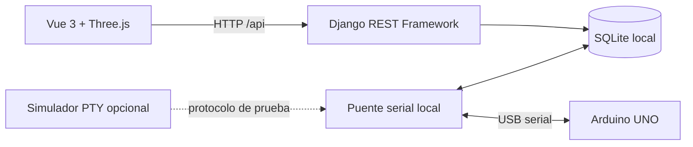

# Arquitectura y protocolo



Django expone vistas, serializers de entrada, servicios de reglas y repositorios. El puente es un comando de Django independiente que abre el puerto serial de la computadora donde también vive su base de datos. El navegador nunca accede directamente al USB. Si Django corre en la nube, **no ve el USB de la computadora del usuario**: para esta versión hay que ejecutar Django y el puente localmente. Un agente que se comunique de forma segura con un servidor remoto es trabajo futuro.

## Fuentes de verdad

- **Simulación:** Vue mantiene el grafo dirigido, fases virtuales, vehículos, rutas, cierres y luces añadidas virtualmente. No se envían al Arduino. Al cambiar tiempos en este modo se reinician el reloj y los vehículos de la simulación.
- **Dispositivo:** Django muestra solo el último `ESTADO` serial recibido hace como máximo cuatro segundos. Los seis semáforos 3D muestran esos colores usando la asignación propuesta S1→I1 hasta S6→I6; se apagan visualmente si el puente se detiene, la API falla o la telemetría caduca. Los vehículos y los semáforos adicionales son solo simulados y se ocultan o apagan en este modo.
- **Simulador serial:** emite `ESTADO,SIMULADO,...`; la interfaz lo identifica como prueba, sin presentarlo como Arduino físico.

El Arduino informa qué salidas ordenó encender. No hay sensores que confirmen que un LED físico realmente brilla, ni sensores de tráfico. La variación de tráfico es simulada y **nunca modifica automáticamente** los tiempos del Arduino. En modo dispositivo, una persona debe solicitar el cambio.

## Comunicación USB

El puente enumera puertos con `pyserial` (`--listar`) y abre el puerto indicado a 115200 baudios. Al abrir el puerto el UNO puede reiniciarse; `INICIO,1` invalida estados y configuraciones pendientes. El puente reintenta al perder la conexión. No envía solicitudes antiguas automáticamente tras un reinicio o desconexión.

Mensajes ASCII terminados en salto de línea:

```text
Arduino → puente: INICIO,1
Arduino → puente: ESTADO,BLOQUEADO,R,R,R,R,R,R
Arduino → puente: ESTADO,ACTIVO,V,R,R,R,R,R
Puente → Arduino: CONFIG,17,30,15,3,2
Arduino → puente: ACK,17,APLICADO,OK
Arduino → puente: ACK,17,RECHAZADO,VALORES
```

Los seis colores son `R` rojo, `A` amarillo y `V` verde. `PRUEBA` indica una prueba individual de LED; `SIMULADO` identifica el emulador PTY. `CONFIG` contiene identificador, verde principal, verde secundaria, amarillo y todo rojo, en segundos. Django y el firmware validan los mismos límites. En funcionamiento activo, el firmware espera una fase de todo rojo para aplicar tiempos y solo entonces emite `APLICADO`; mientras está bloqueado puede guardar los tiempos en RAM sin activar luces. El reinicio restaura los tiempos predeterminados y borra la confirmación. Si se pierde el ACK, el estado se marca interrumpido: no se debe asumir que el cambio se aplicó. El puente vence una solicitud enviada sin respuesta después de 150 s.

La base y la API son para uso local de desarrollo. No hay autenticación, autorización ni cifrado de transporte: no publicar estos endpoints para control remoto sin implementarlos.

## Rutas y prioridad

La cuadrícula es una aproximación de la foto. Cada calle se divide en tramos dirigidos; en cada nodo un vehículo puede seguir o girar hacia otra vía de salida, nunca contra una flecha. Una búsqueda en anchura evita tramos cerrados. Si el destino original deja de ser alcanzable, el simulador intenta otra salida; si ninguna es alcanzable, espera. Si se cierra el tramo que ocupa, el vehículo queda detenido hasta que se reabra. Una reserva evita que dos vehículos entren al mismo cruce a la vez.

Cada cruce virtual alterna verde principal, amarillo, todo rojo, verde secundaria, amarillo y todo rojo. Los tiempos son globales para las seis intersecciones. El rojo de cada vía se calcula para mantener la seguridad: rojo principal = verde secundaria + amarillo + 2 × todo rojo; rojo secundaria = verde principal + amarillo + 2 × todo rojo. Así se puede modificar el rojo mediante los demás tiempos sin permitir fases incompatibles.

Los seis ciclos usan más tiempo verde principal y desfases para una ola verde **virtual** a 30 km/h sobre una escala supuesta. El firmware físico, si se habilita tras confirmar el mapa, sincroniza sus fases de forma global; no tiene offsets ni ola verde física verificada. Los sentidos y distancias reales de la maqueta deben medirse antes de diseñar esa coordinación.

## ESP32 por Wi-Fi (futuro)

Una futura versión necesitaría firmware ESP32, identificación y autenticación del dispositivo, canal cifrado, reconexión y caducidad de telemetría, comandos con identificador y confirmación, y un servicio en Django para recibir eventos. También habría que adaptar la electrónica a 3,3 V y las corrientes del ESP32. Nada de esto está implementado o probado aquí.
